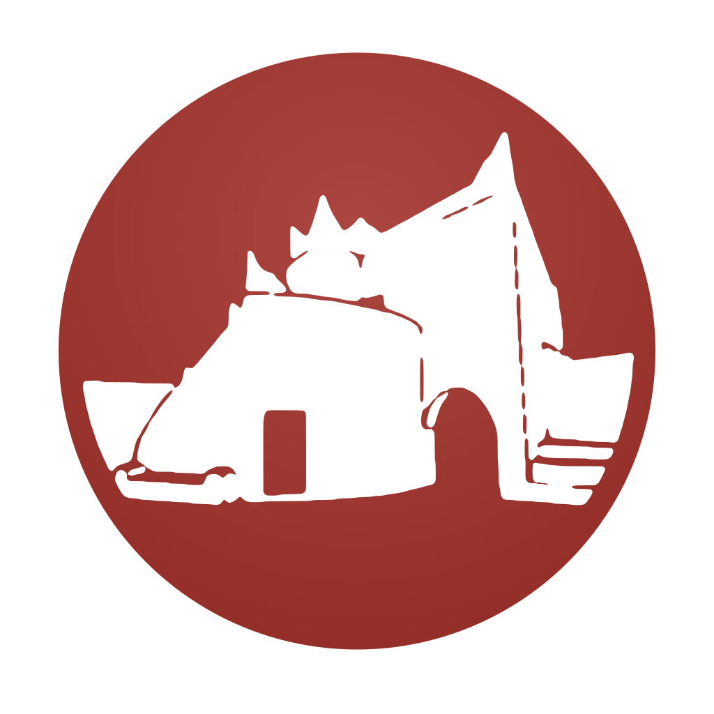
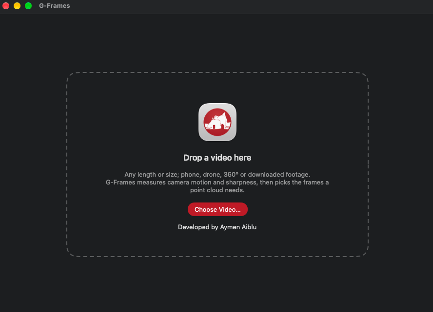

<p align="center"></p>

# G-Frames

[](https://doi.org/10.5281/zenodo.23674120)

**Overlap-driven video frame selection for photogrammetry.** Developed by **Aymen Aiblu**.

G-Frames is a native macOS app (SwiftUI, Apple Silicon) that turns a video of any length or size into a photogrammetry-ready image set. It analyses the whole video first and works out how many frames the reconstruction needs. It then extracts only those: the sharpest candidates, at a consistent overlap, into a COLMAP-ready folder. People and burned-in logos are masked, never painted over.

It was built for remote documentation of the Old Town of Ghadames (Libya), a UNESCO World Heritage Site, as part of doctoral research at Carleton University's School of Architecture and Urbanism.

<p align="center"></p>

## Install with Xcode (no Terminal)

Requires Xcode (free from the Mac App Store) on macOS 14 or later.

1. In Finder, double-click **GFrames.xcodeproj**. Xcode opens the project.
2. If Xcode asks to install additional components or to trust the project, accept.
3. Menu **Product › Archive**. Xcode builds an optimised release (one to three minutes) and opens the Organizer window with the archive selected.
4. In the Organizer, right-click the archive › **Show in Finder**. Right-click the `.xcarchive` file › **Show Package Contents**, then open **Products › Applications**.
5. Drag **G-Frames.app** into your **Applications** folder. Open it from Launchpad or Applications from now on.

The project signs the app to run locally on your Mac, so no Apple developer account is needed. **Product › Run** also works for a quick test (it uses the Release configuration, so analysis runs at full speed).

## Install by double-clicking

Double-click **Install G-Frames.command**. A window opens and runs the build script below by itself. If macOS says the file can't be opened because it is from the internet, open **System Settings › Privacy & Security**, scroll down, click **Open Anyway** next to the message, and double-click the file again.

## Build and install (one command)

Requires macOS 14+ and the Xcode Command Line Tools (already present if you build COLMAP from source).

```
cd ~/Downloads/G-Frames
bash build.sh
```

The script compiles a release build, assembles `G-Frames.app` with its icon, ad-hoc signs it, installs it to `/Applications` (or `~/Applications`) and launches it. Re-run it after any source change.

## Using it

1. **Drop a video** (or ⌘O). Streams from disk via AVFoundation — no size or length limit, constant memory. 360° footage is auto-detected from the 2:1 frame shape.
2. **Analyse.** One decode pass measures, for every analysed frame, camera motion (sparse pyramidal Lucas–Kanade with forward–backward checking) and sharpness (Laplacian variance relative to the local 80th percentile). Standard density samples 10 frames/s; Fine samples up to 30/s for more candidates per step.
3. **Frames.** The recommended count appears immediately. Adjust **Overlap** (default 80%) and **Blur rejection**; the count, chart and preview update instantly without re-analysing.
4. **Export.** Writes JPEGs plus provenance files into a new `<video>_frames` folder.

## How the count is decided

Camera travel is accumulated as median normalised optical flow (in "frame widths"). A new keyframe is due every `1 − overlap` of travel. Within each step the app considers all candidates between 0.5 and 1.0 step and takes the sharpest; if all are blurry it looks up to 1.5 steps ahead before accepting a soft frame (flagged `quality_ok = no`). Static stretches produce no duplicates; tracking loss (cuts in mixed footage, extreme blur, textureless views) starts a new segment.

Validated on synthetic footage with known camera footprints (variable speed, pauses, blur bursts, forward motion, a hard cut, fast pans): measured overlap between consecutive picks stayed within about 0.04 of the target, pauses yielded no duplicates, and blur bursts were skipped or flagged. The scripts and results are in [`validation/`](validation/).

## People

With **Detect people** on (default), every analysed frame is run through Apple's on-device person segmentation (Vision framework; nothing leaves the Mac). Two things follow:

- **Crowd-aware selection.** Within each overlap step, candidates are scored by relative sharpness × (1 − people coverage)³, and frames more than 50% covered by people count as unusable unless nothing better exists. On synthetic tests this cut the average share of each chosen frame covered by people by 5–36% (median about 25%), with overlap staying near target.
- **Person masks.** With **Export person masks** on, each image gets `masks/<image>.jpg.png` (white = use, black = ignore). Masks come from full-quality segmentation plus rectangles for small, distant people, grown by 1.2% of the long edge to cover hair, edges and motion blur.

Nothing is painted over. Inpainting invents pixels that differ from view to view, which photogrammetry turns into false geometry. Masks only tell the reconstruction to ignore those pixels, so the surface behind a person is rebuilt from the views where it is actually visible. A surface hidden by people in *every* view cannot be recovered this way — film at quieter times or from more angles. Shadows cast by people are not masked.

Using the masks:
- **COLMAP**: `colmap.sh` adds `--ImageReader.mask_path masks` automatically.
- **Metashape**: File › Import › Import Masks › From File, template `{filename}.jpg.png`; apply masks to tie points and depth maps.
- **OpenMVS**: check whether your build of `DensifyPointCloud` has a mask option (`--help`).

## Burned-in overlays

Downloaded and broadcast footage often carries a channel logo, caption, timestamp or letterbox bars that stay fixed on screen while the camera moves. To a reconstruction these look like features with zero motion, which corrupts camera-pose estimation. During analysis G-Frames finds pixels that are textured but do not change between moving frames, boxes each compact region, and masks it in every exported image (**Mask burned-in overlay**, on whenever one is found). Tested on synthetic footage with a burned-in logo and caption: 97% of the overlay area was masked, with the mask confined to boxes around the two overlays. Nothing was masked on the same footage without overlays. A fixed camera (tripod) is recognised and not treated as an overlay. Not applied to 360° footage.

## 360° video

Each selected frame is reprojected into 8 perspective views (90° FOV, 45° apart → 50% overlap between neighbours), optionally plus 4 up (+40°) and 4 down (−40°). All views share one exact pinhole camera, so `colmap.sh` passes the intrinsics directly. Files are named `<name>_00012_v03.jpg` so sequential matching sees all views of a moment together.

## Output

```
<video>_frames/
  images/         <name>_00001.jpg …  (ASCII-only names, EXIF Make/Model/35 mm focal when known)
  masks/          <name>_00001.jpg.png …  person masks (when enabled)
  frames.csv      file → source frame, timestamp, sharpness, travel, segment, quality flag, people estimate, masked share
  analysis.json   every analysed sample + all parameters (reproducible methodology record)
  report.txt      summary and warnings
  colmap.sh       feature_extractor → sequential (or exhaustive, if segmented) matcher → mapper
```

Run `./colmap.sh` in that folder, or `COLMAP=/path/to/your/colmap ./colmap.sh` to use a specific build.

## Footage tips

- Turn off digital stabilisation and keep zoom fixed: the script assumes one camera with constant intrinsics.
- Slow, steady orbits beat fast pans; motion blur is the main cause of flagged frames.
- `.mkv`/`.webm` downloads aren't readable by macOS; remux to `.mp4` with ffmpeg first (the app tells you the command).
- For crowd-sourced clips with many cuts, the report and `colmap.sh` switch to exhaustive matching automatically (up to 1,500 images).

## Source layout

```
Sources/GFrames/
  GFramesApp.swift, ContentView.swift, AnalysisChart.swift, AppModel.swift, Theme.swift   UI + state
  Engine/VideoProbe.swift     metadata, rotation, 360 detection, reader setup
  Engine/Analyzer.swift       streaming analysis pass (vImage downsampling, sharpness, motion)
  Engine/LKTracker.swift      pyramidal Lucas–Kanade, Shi–Tomasi seeding, fwd–bwd check
  Engine/GrayImage.swift      float image ops, Laplacian variance
  Engine/FrameSelector.swift  overlap-driven, sharpness-aware keyframe selection
  Engine/PeopleMasker.swift   Vision person detection: fast coverage probe, full-quality masks
  Engine/OverlayDetector.swift  burned-in logo / caption detection
  Engine/Extractor.swift      second pass: decode selected frames, rotate, scale, encode in parallel
  Engine/Equirect.swift       equirectangular → perspective reprojection
  Engine/ImageWriter.swift    JPEG + EXIF via ImageIO
  Engine/Report.swift         csv / json / report / colmap.sh
  Assets.xcassets             app icon (Xcode build)
GFrames.xcodeproj             Xcode project (same sources, synchronised folder)
Package.swift, build.sh       Swift Package Manager build used by build.sh
validation/                   Python reference implementation and synthetic tests
```

## Citing G-Frames

If you use G-Frames in research, please cite it. GitHub's **Cite this repository** button (from `CITATION.cff`) gives APA and BibTeX.

> Aiblu, A. (2026). *G-Frames: overlap-driven video frame selection for photogrammetry* (Version 1.1.0) [Computer software]. Zenodo. https://doi.org/10.5281/zenodo.23674120

## Development

G-Frames was designed and specified by Aymen Aiblu, who set its requirements, selection strategy, masking approach and output format, and who tested and validated it. The code was written with AI-assisted programming (Claude, Anthropic). The selection rules were checked against synthetic ground truth (see `validation/`) before use on real footage.

## Licence

MIT. See [LICENSE](LICENSE). © 2026 Aymen Aiblu.
